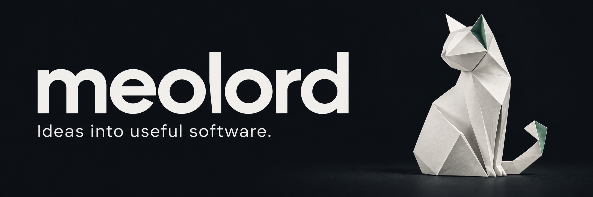

  

## Ideas into useful software.

I build AI applications, developer tools, and everyday utilities, with care for the user experience.

[Explore all projects](https://github.com/shenmuegit?tab=repositories)

### Current work

**[AppleHomePod for Windows](https://github.com/shenmuegit/AppleHomePod-windows)** 
Play Windows music, video, and system audio through HomePod over your local network, using the Windows output menu and volume controls. 
C# · .NET · Rust · Preview; validated with one HomePod mini on Windows 10

**[Codex Console](https://github.com/shenmuegit/codex-console)** 
Access your Codex workspace from a mobile browser, with a native app-server Web client and a Linux desktop-window streaming option. 
JavaScript · Mobile Web · Developer tools

**[codex-transient-retry](https://github.com/shenmuegit/codex-transient-retry)** 
Local buffered retries for transient Codex model and remote compaction failures, with guarded Windows setup. 
Python · Codex · Reliability

**[Isola](https://github.com/shenmuegit/Isola)** 
A shared home for independent React plugins, with a Web client, server, marketplace, and public SDK in development. 
TypeScript · React · Plugin framework · Web development preview

**[WhaleKey](https://github.com/shenmuegit/whalekey)** 
An Android Chinese keyboard based on Fcitx5 Android, exploring offline Pinyin input and on-device text rewriting. 
Kotlin · Android · On-device AI · Early development

### Selected projects

**[StackCat](https://github.com/shenmuegit/StackCat)**  
Runtime call tracing and analysis for Java applications. Explore method calls, SQL, and performance bottlenecks.  
Java · Java Agent · Spring Boot

**[PestiGraph](https://github.com/shenmuegit/PestiGraph)**  
A pesticide registration knowledge graph built on Microsoft GraphRAG, with search, Q&A, and interactive visualization.  
Python · GraphRAG · Knowledge graphs

**[WordHook](https://github.com/shenmuegit/WordHook)**  
Learn English as you browse: highlight text for AI explanations and local text-to-speech, then save what you learn to Anki.  
JavaScript · Chrome extension · LLM

---

Feedback and suggestions are welcome in each project's Issues.
